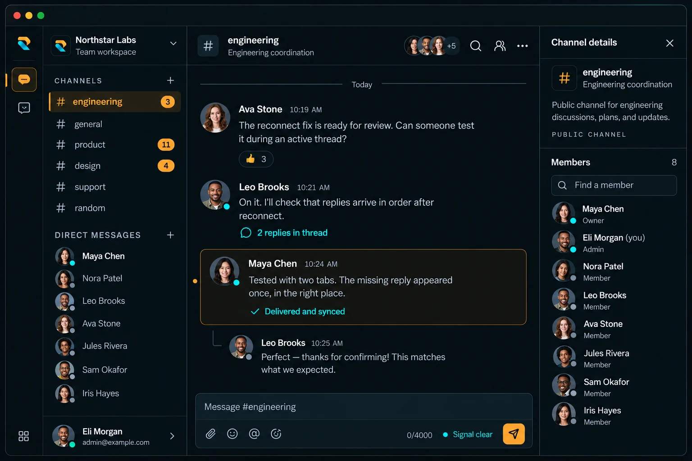

<div align="center">
  
  <h1>Relay</h1>
  <h3>Keep the conversation moving.<br />Even when the connection does not.</h3>
  <p>Channels, direct messages, and team context.<br />One focused workspace for small remote teams.</p>

  <p>
    
    
    
    
  </p>

  <p><strong>Real time &nbsp; / &nbsp; Durable &nbsp; / &nbsp; Recovery ready</strong></p>
  <p>
    <a href="#the-product">Explore the product</a> &nbsp; / &nbsp;
    <a href="#quick-start">Run locally</a> &nbsp; / &nbsp;
    <a href="#under-the-hood">Under the hood</a>
  </p>
  <br />
  
  <br />
  <sub>Conversation that stays in sync.</sub>
</div>

<br />

## The product

Remote teams should not have to choose between fast conversation and dependable history. **Relay keeps everyday communication immediate while treating every durable event as data that must survive retries, reconnects, and multiple devices.**

<table>
  <tr>
    <td width="33%" valign="top">
      <h3>01 / Talk</h3>
      <p>Public channels and one-to-one conversations keep team discussion focused.</p>
      <strong>Communication without the clutter.</strong>
    </td>
    <td width="33%" valign="top">
      <h3>02 / Coordinate</h3>
      <p>Replies, reactions, presence, typing, files, and search keep context close.</p>
      <strong>Shared awareness in the flow.</strong>
    </td>
    <td width="33%" valign="top">
      <h3>03 / Recover</h3>
      <p>Durable storage, deduplicated sends, and reconnect sync restore missed activity.</p>
      <strong>No lost context after a drop.</strong>
    </td>
  </tr>
</table>

### Built around the message stream

| Capability | What it brings to the team |
| --- | --- |
| **Channels and DMs** | Focused public discussions and private one-to-one conversations |
| **Reliable delivery** | Optimistic sends reconciled with canonical server IDs and timestamps |
| **Reconnect recovery** | Missed durable events restored from PostgreSQL without duplicates |
| **Replies and reactions** | Lightweight context and acknowledgement without leaving the conversation |
| **Presence and typing** | Ephemeral activity coordinated through Redis across tabs and sessions |
| **Files and search** | Authorized attachments and PostgreSQL-backed message discovery |
| **Unread state** | Durable read position and consistent activity indicators |
| **Workspace roles** | Owner, Admin, and Member permissions enforced by the server |

### Reliability is a product feature

- **PostgreSQL is the source of truth.** Socket.IO delivers immediate events but never replaces persistence.
- **Retries are safe.** Client operation IDs reconcile optimistic messages and prevent duplicate sends.
- **Authorization is explicit.** HTTP requests, socket handshakes, events, rooms, files, and queries are checked server-side.
- **Connection state stays legible.** Presence and typing may degrade, while durable communication remains available.

---

## Quick start

**You'll need:** Node.js **24.x LTS**, npm, and Docker Compose.

### 1. Get the project

```bash
git clone https://github.com/AshrafMurad/relay.git
cd relay
npm --prefix frontend ci
npm --prefix backend ci
cp frontend/.env.example frontend/.env.local
cp backend/.env.example backend/.env
```

<details>
<summary><strong>Using Windows PowerShell?</strong></summary>

Use `Copy-Item frontend/.env.example frontend/.env.local` and `Copy-Item backend/.env.example backend/.env` for the environment-copy steps.

</details>

### 2. Prepare the services

```bash
docker compose -f docker/compose.dev.yml up -d
npm --prefix backend run prisma:generate
npm --prefix backend run prisma:migrate:deploy
npm --prefix backend run seed
```

The development stack starts PostgreSQL, Redis, and Mailpit. The seed creates the Northstar Labs demo workspace with channels, direct messages, replies, reactions, read state, and an attachment.

### 3. Start Relay

Run the applications in separate terminals:

```bash
npm --prefix backend run dev
```

```bash
npm --prefix frontend run dev
```

**[Open Relay](http://localhost:3000)** &nbsp; / &nbsp; **[Inspect email in Mailpit](http://localhost:8025)**

<details>
<summary><strong>Demo accounts</strong></summary>

All seeded users share `DEMO_PASSWORD`, which defaults to `123456` for local development.

| Role | Email |
| --- | --- |
| Owner | `owner@example.com` |
| Admin | `admin@example.com` |
| Member | `user@example.com` |

Additional members are available as `user2@example.com` through `user6@example.com`. Use separate browser profiles or a regular and private window for two-user real-time testing.

</details>

<details>
<summary><strong>Local endpoints</strong></summary>

| Service | Address |
| --- | --- |
| Relay web | `http://localhost:3000` |
| Express API and Socket.IO | `http://localhost:4000` |
| PostgreSQL | `localhost:5432` |
| Redis | `localhost:6379` |
| Mailpit SMTP | `localhost:1025` |
| Mailpit web interface | `http://localhost:8025` |

</details>

---

## Under the hood

Relay is intentionally two independent applications, not an npm workspace. Next.js owns rendering and browser interaction; Express owns domain behavior, authorization, persistence, and real-time events.

| Layer | Stack |
| --- | --- |
| Web | Next.js 16, React 19, TypeScript |
| Interface | Tailwind CSS 4, Base UI, shadcn/ui |
| API | Express 5, Zod |
| Real time | Socket.IO 4, Redis |
| Data | PostgreSQL 18, Prisma 6 |
| Quality | ESLint, Vitest, Playwright |
| Delivery | Docker, Compose, Coolify |

<details>
<summary><strong>Explore the codebase</strong></summary>

```text
relay/
|-- frontend/
|   |-- app/              Routes, layouts, and health endpoint
|   |-- components/       Product surfaces and UI primitives
|   |-- lib/              API, auth, i18n, and realtime clients
|   `-- tests/            Browser tests
|-- backend/
|   |-- src/modules/      Domain routes and services
|   |-- src/realtime/     Socket.IO server and events
|   |-- prisma/           Schema, migrations, and demo seed
|   `-- tests/            Unit and integration tests
`-- docker/               Development and production infrastructure
```

</details>

<details>
<summary><strong>Development and verification commands</strong></summary>

| Command | Purpose |
| --- | --- |
| `npm --prefix frontend run dev` | Start the Next.js development server |
| `npm --prefix backend run dev` | Start the Express and Socket.IO server |
| `npm --prefix frontend run lint` | Lint the frontend |
| `npm --prefix frontend run typecheck` | Type-check the frontend |
| `npm --prefix frontend test` | Run frontend unit tests |
| `npm --prefix frontend run test:e2e` | Run Playwright browser tests |
| `npm --prefix backend run lint` | Lint the backend |
| `npm --prefix backend run typecheck` | Type-check the backend |
| `npm --prefix backend test` | Run backend unit tests |
| `npm --prefix backend run test:integration` | Run database and Redis integration tests |

Integration tests require the Docker services. The default Playwright run builds and starts a test server; install Chromium once with `npx --prefix frontend playwright install chromium`.

</details>

<details>
<summary><strong>Health and degradation</strong></summary>

| Check | URL | Meaning |
| --- | --- | --- |
| Web process | `http://localhost:3000/healthz` | Next.js is serving requests |
| API liveness | `http://localhost:4000/api/health/live` | The API process is alive |
| API readiness | `http://localhost:4000/api/health/ready` | PostgreSQL is available; Redis status is reported separately |

If Redis is unavailable, readiness reports degraded operation. Durable PostgreSQL-backed messaging remains available while ephemeral presence and typing are unavailable.

</details>

<details>
<summary><strong>Production deployment</strong></summary>

Production uses one public origin with `/` routed to Next.js and `/api/*` plus `/socket.io/*` routed to Express. Configure secrets outside source control, apply Prisma migrations as a controlled release step, and mount attachment storage on a persistent volume.

`docker/compose.prod.yml` defines the production services. A release should finish with health checks and a two-user smoke test covering live delivery, reconnect recovery, and authorized file access.

</details>

<br />

<div align="center">
  <hr />
  <br />
  
  <p><strong>Fast when connected. Dependable when reconnecting.</strong></p>
  <sub>Relay / Real-time communication that keeps its word.</sub>
  <br /><br />
  <a href="#relay">Back to top</a>
</div>
